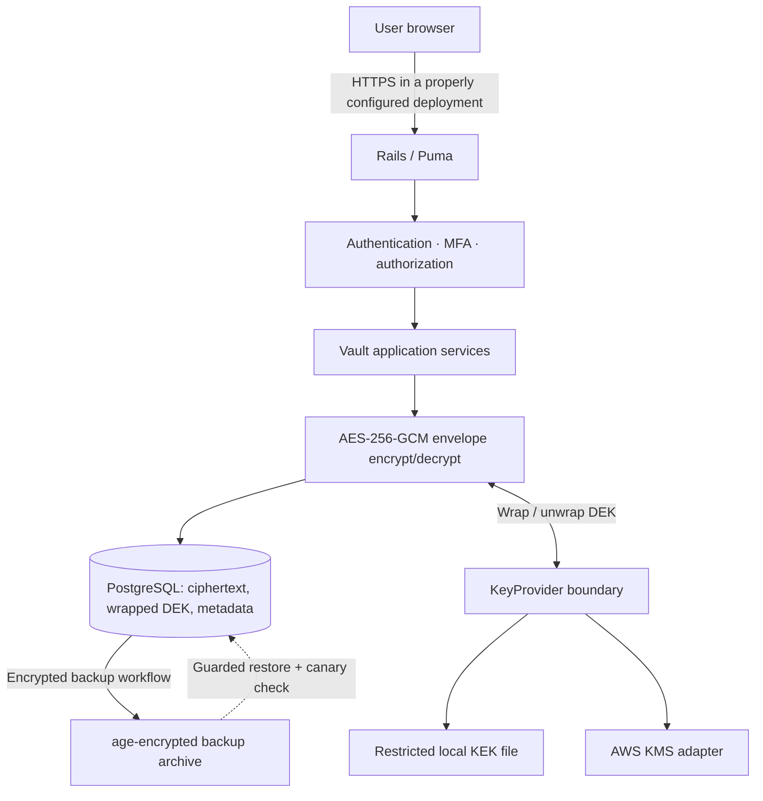

# Ruby Envelope Vault

> 🌐 Language / Ngôn ngữ: **English** | [Tiếng Việt](README.vi.md)

[](https://github.com/dangkhoa2016/Rails-8-Envelope-Encryption-Vault/actions/workflows/ci.yml)
[](https://github.com/dangkhoa2016/Rails-8-Envelope-Encryption-Vault/actions/workflows/docs.yml)
[](https://github.com/dangkhoa2016/Rails-8-Envelope-Encryption-Vault/tree/v1.0.0)
[](LICENSE)


[](docs/ARCHITECTURE.md)
[](docs/KEY-MANAGEMENT.md)
[](docs/README.md)

**A self-hosted Ruby on Rails 8 vault for encrypted credentials, API keys, environment variables and private notes—with authenticated envelope encryption, immutable versions, access controls and recovery tooling.**

**Release scope:** `v1.0.0` includes the Rails application, reproducible Kaggle/Colab demo, security test workflows and bilingual engineering documentation. Independent host-specific deployment acceptance is described in the [production checklist](docs/PRODUCTION-CHECKLIST.md); see the [qualification matrix](docs/qualification.md) for evidence boundaries.

[Get started](#quick-start--notebook-or-container) · [Understand encryption](#how-envelope-encryption-works) · [Review evidence](#verification-and-evidence) · [Explore all documentation](#documentation-map)

## Contents

- [Choose your review path](#choose-your-review-path)
- [Example lifecycle](#example-one-secret-through-its-lifecycle)
- [Release evidence and badges](#release-evidence-how-to-interpret-the-badges)
- [What this project is](#what-this-project-is)
- [Capabilities and workflows](#capabilities-and-workflows)
- [System architecture](#system-architecture)
- [How envelope encryption works](#how-envelope-encryption-works)
- [Security boundaries and threat model](#security-boundaries-and-threat-model)
- [Quick start — notebook or container](#quick-start--notebook-or-container)
- [Standard Rails development](#standard-rails-development)
- [Using the vault](#using-the-vault)
- [Key rotation, backup and disaster recovery](#key-rotation-backup-and-disaster-recovery)
- [Verification and evidence](#verification-and-evidence)
- [Production readiness](#production-readiness)
- [Documentation map](#documentation-map)
- [Contributing and license](#contributing-and-license)

## Choose your review path

| I want to... | Recommended starting point | What I can verify |
| --- | --- | --- |
| Understand the product in five minutes | [Feature overview](#capabilities-and-workflows) and [usage walkthrough](#using-the-vault) | Available UI workflows and access boundaries |
| Audit the encryption implementation | [Architecture](docs/ARCHITECTURE.md), [threat model](docs/THREAT-MODEL.md), then `app/services/crypto/` | Fresh DEK, GCM authentication, AAD and wrapped-key behavior |
| Run a disposable demo | [Quick start](#quick-start--notebook-or-container) and [notebook guide](docs/KAGGLE-SETUP.md) | Bootstrap, local service health and sample-only operations |
| Reproduce release tests | [Reproducibility](docs/reproducibility.md) and [qualification](docs/qualification.md) | Test matrix, source SHA, CI evidence and test limitations |
| Evaluate key custody and recovery | [Key guide](docs/KEY-MANAGEMENT.md) and [backup/DR](docs/BACKUP-RESTORE.md) | KEK rotation, encrypted backups, guarded canary restoration |
| Prepare an operational deployment | [Deployment](docs/deployment.md), [checklist](docs/PRODUCTION-CHECKLIST.md) | Independent production acceptance requirements |

This project deliberately separates **source verification** from **production acceptance**. A published tag or successful test run is an input to operational review—not permission to put real credentials on an unassessed host.

## Example: one secret through its lifecycle

| Stage | User-visible action | Security or persistence behavior |
| --- | --- | --- |
| Create | Add a fictional login credential | Payload is authenticated-encrypted with a new DEK; metadata and wrapped key are persisted |
| Organize | Assign a type, search, favorite or archive | Per-user access controls apply; non-payload metadata remains visible to authorized database operators |
| Reveal | Request the protected value | Authorization and, where required, reauthentication precede controlled decryption |
| Update | Change the fictional password | A newly encrypted immutable version is created, retaining prior history |
| Restore | Select an earlier version | Its plaintext is recovered under authorization and written as a *new* encrypted version |
| Investigate | Check session and audit views | Security-relevant events support review without placing raw secrets in audit records |
| Recover | Retrieve an encrypted backup and restore a fake canary | Recovery requires the appropriate age identity **and** historical KEK, not only a PostgreSQL dump |

The repository contains actual Rails services and tests for these paths; see [engineering overview](docs/engineering-overview.md). It does not claim end-to-end encryption from an untrusted server or protection against a compromised authorized Rails process.

## Release evidence: how to interpret the badges

The **CI** and **Documentation** badges above link to live GitHub Actions workflows; they are not hard-coded PASS labels. Static version, technology and license badges describe repository metadata rather than runtime attestation.

For a specific release, inspect the **exact commit SHA** on [Actions](https://github.com/dangkhoa2016/Rails-8-Envelope-Encryption-Vault/actions) and compare the executed jobs with the [qualification matrix](docs/qualification.md). The [production checklist](docs/PRODUCTION-CHECKLIST.md) explains independent host acceptance before storing real secrets.

## What this project is

Ruby Envelope Vault is a reviewable implementation of **server-side encryption for personal and operational secrets**. Its objective is to reduce the consequences of a database-only disclosure by keeping plaintext and the unwrapped key-encryption key (KEK) out of persisted PostgreSQL rows.

The project combines an everyday vault UI with engineering concerns that are frequently omitted from small demonstration apps: per-version cryptographic isolation, key-provider boundaries, authentication and MFA, append-only version creation, audit metadata, guarded recovery, and source-level release qualification.

**Who it is for:** Ruby/Rails developers learning authenticated encryption, teams evaluating self-hosted secret handling, and operators studying backup/KEK separation. It is a reference implementation requiring an independent security and operations review before protecting real-world critical secrets.

### Technology at a glance

| Layer | Implementation | Responsibility |
| --- | --- | --- |
| Web application | Rails 8.1.4, Puma, Hotwire (Turbo/Stimulus), Tailwind CSS | Authenticated UI, workflows and server-rendered interactions |
| Database | PostgreSQL 17 | Users, vault metadata, encrypted versions, wrapped DEKs and audit events |
| Payload encryption | OpenSSL AES-256-GCM | Authenticated confidentiality and integrity per immutable version |
| Key custody | Local-file KEK or AWS KMS adapter | Wrap/unwrap DEKs outside the database boundary |
| Identity and access | Password authentication, TOTP MFA, recovery codes, sessions | User access, sensitive-action reauthentication and session control |
| Engineering | Rails tests, system tests, RuboCop, Brakeman, bundler-audit, Docker | Source validation, static checks and reproducibility |

The pinned runtime is [Ruby 3.4.11](.ruby-version); CI also exercises Ruby 4.0 compatibility. These are **tested environments**, not an unrestricted platform support guarantee.

## Capabilities and workflows

| Feature | What the application provides |
| --- | --- |
| Seven item templates | Login, API key, environment variables, database, secure note, server/SSH, custom secret |
| Vault management | Create, edit, list, search, filter by category/tag/state, favorite and archive items |

The Vault displays **Active** items by default. Archive hides an item from daily results but retains encrypted data and version history. Select **Archived** or **All states** to find it, then **Unarchive** to return it to Active. Archiving does not revoke external credentials.
| Encrypted versions | Every update creates a new encrypted version; restore creates a new version instead of changing history in place |
| Controlled access | Authorized reveal/export, reauthentication for sensitive actions, per-user ownership checks |
| Account protection | TOTP MFA, hashed recovery codes, session expiry/revocation and rate-limiting controls |
| Auditability | Account-scoped Security Activity Center with time/outcome filters, a dated event timeline and safe detail previews |
| KEK operations | Generate/verify KEKs, read-only older keys, DEK rewrapping and provider diagnostics |
| Recovery operations | age-encrypted PostgreSQL dumps, SHA-256 checks, guarded restore and canary-decrypt DR rehearsal |

This is **not** a shared team secret manager with a published high-availability service-level guarantee; evaluate its existing access model and operational assumptions before extending it.

## Security Activity Center

The upcoming **Security Activity Center** improves Audit Log with account-linked security metrics, 7/30/90-day or all-time filtering, explicit Completed/Failed/Recorded outcomes, responsive timelines and safe event details. Only events attributed to your authenticated account are displayed. Anonymous sign-in failures and system-wide key rotations are **not** represented in personal metrics.

The Security Activity Center is included in the `v1.0.0` community source release. The account timeline is not an operator-wide intrusion monitoring feed or a cryptographically tamper-evident system log. Read the [bilingual Audit security specification](docs/AUDIT-ACTIVITY.md) for scope, safeguards and limitations. Production acceptance and manual mobile accessibility checks remain separate.

The Activity Center also displays bounded authentication request evidence (resolved IP address, User-Agent/browser/OS and safe HTTP method/path) and owner-checked links to existing Vault items; archived items remain accessible, removed or unauthorized items never receive links. Historical events are not backfilled.\n\n
## System architecture



The database stores the authenticated encrypted payload and the wrapped data-encryption key. **KEK material belongs to a separate trust boundary**; keeping a copy alongside the database backup would defeat much of the intended separation.

Start with the [architecture](docs/ARCHITECTURE.md), [engineering overview](docs/engineering-overview.md) and [key management guide](docs/KEY-MANAGEMENT.md).

## How envelope encryption works

Each immutable secret version is encrypted independently:

1. The application generates a **new random 32-byte (256-bit) DEK** and a **12-byte GCM nonce**.
2. The secret's serialized payload is encrypted with AES-256-GCM.
3. Authenticated additional data (AAD) binds the encrypted version to its user, vault item and version identifiers.
4. A configured `KeyProvider` wraps the DEK using an independently controlled KEK.
5. PostgreSQL persists the ciphertext, nonce, authentication tag, provider identity, KEK identifier and wrapped DEK—not the raw DEK or KEK.
6. Decryption requires authorized application access, successful DEK unwrapping and valid GCM authentication. A mismatched context or tampered envelope must fail authentication.

```text
SECRET + fresh DEK + nonce + AAD
    ├─ AES-256-GCM ───────────────► ciphertext + authentication tag
    └─ DEK ── wrap via KEK ───────► wrapped DEK + KEK ID
                                    │
                         PostgreSQL encrypted version
```

KEK rotation can **rewrap existing DEKs without rewriting secret ciphertext**. The process verifies the newly wrapped DEK and retains old keys as needed for older backups; it is not a reason to delete historical recovery material.

For exact formats and failure behavior, consult the source under `app/services/crypto/` and `app/services/key_providers/`, plus [key management](docs/KEY-MANAGEMENT.md).

## Security boundaries and threat model

| Scenario | Intended protection | Important limitation |
| --- | --- | --- |
| Database-only leak | Stored secret payloads remain encrypted; KEK is not in PostgreSQL | Titles, item metadata and other non-payload data still require confidentiality controls |
| Modified ciphertext, tag or AAD context | AES-GCM authentication rejects invalid envelopes | Availability and deletion are not prevented by encryption |
| Stolen browser session | Session controls, reauthentication and MFA reduce risk | A valid authorized session still carries access risk |
| Compromised live app or KEK provider | Separation can constrain some incidents | An authorized compromised Rails process may decrypt secrets |
| Database backup theft | age encryption protects the database dump when configured | Recovery identity and all referenced KEKs must be protected separately |
| Loss of a KEK | Independent key custody supports recovery | A database dump **cannot** recover secrets without the required KEK |

**No zero-knowledge claim:** encryption takes place on the server. This project is not audited or certified as a production password manager, HSM replacement, or compliance solution. Read the [threat model](docs/THREAT-MODEL.md) and [security disclosure policy](docs/SECURITY.md).

## Quick start — notebook or container

The supported convenience workflow is designed for **Kaggle, Google Colab and similar Ubuntu/Debian containers** without systemd. Use **synthetic data only**. Installation needs package/network access, sufficient disk space and a writable runtime directory.

**Recommended Kaggle / Google Colab demo:** [Ruby Envelope Vault Full Demo](notebooks/Ruby_Envelope_Vault_Kaggle_Colab_Full_Demo.ipynb) is the **only supported notebook** in this branch. It pins the reviewed application commit `0c6dcfe43ab610dbbe9cc1cd669ce345127980da` and validates its Git tree before setting up the demo. The notebook runs full Rails/Selenium tests and uses encrypted synthetic records; follow the [bilingual setup guide](docs/KAGGLE-SETUP.md).

**Source version and review scope**

| Source | What a reviewer gets | Verification |
| --- | --- | --- |
| Current `main` | Reactive Audit filters, session-safe Vault search, in-place Favorite toggling, and unified toast notifications | [Current CI](https://github.com/dangkhoa2016/Rails-8-Envelope-Encryption-Vault/actions/workflows/ci.yml) and the pinned notebook |
| [Community source release `v1.0.0`](https://github.com/dangkhoa2016/Rails-8-Envelope-Encryption-Vault/tree/v1.0.0) | Complete Rails application, Security Activity Center, stateful Vault UX, Favorites and shared toasts | Annotated release tag on the final reviewed source commit; the notebook pins its audited application ancestor |

The `v1.0.0` source tag identifies the first community release. Public repositories clone anonymously; private forks or mirrors require an authorized read-only `GH_READ_TOKEN` secret. Use synthetic credentials only. CI does not imply acceptance of a live production deployment.

The notebook **opens a temporary public Cloudflare Quick Tunnel by default, only after Rails becomes healthy**, then displays a clickable browser link without requiring a Cloudflare email OTP. Rails login is still required; use synthetic data, protect the generated demo password and choose `ENABLE_CLOUDFLARE_TUNNEL = False` for localhost-only tests.

```bash
git clone https://github.com/dangkhoa2016/Rails-8-Envelope-Encryption-Vault.git
cd Rails-8-Envelope-Encryption-Vault
git checkout v1.0.0

# Bootstrap provisions services and checks crypto/security; run all Rails tests below.
chmod +x bootstrap.sh
RUN_TESTS=0 START_SERVER=0 ./bootstrap.sh

# Run all Rails and Selenium suites with isolated test-only umask.
(
  source ./activate-runtime.sh
  umask 022
  RAILS_ENV=test bin/rails test
  RAILS_ENV=test bin/rails test:system
)

# Inspect health, then start the development/demo server.
./bootstrap.sh doctor
./bootstrap.sh status
./bootstrap.sh start
```

To create the initial owner **interactively** (in a terminal with stdin), use:

```bash
CREATE_OWNER=1 OWNER_EMAIL='owner@example.com' \
  START_SERVER=0 ./bootstrap.sh
```

The command prompts for a password of at least 14 characters. For headless operation, the bootstrap supports a protected `OWNER_PASSWORD_FILE`; do not put a real password into a Git-tracked script or shell history.

| Command | Purpose |
| --- | --- |
| `START_SERVER=0 ./bootstrap.sh` | Provision/test without keeping the Rails server running |
| `./bootstrap.sh start` | Start managed services and Rails |
| `./bootstrap.sh status` | Report managed runtime/service state |
| `./bootstrap.sh doctor` | Diagnose the app/runtime |
| `./bootstrap.sh stop` | Stop managed PostgreSQL/Redis services |
| `source ./activate-runtime.sh` | Restore environment in a fresh notebook terminal |

Runtime files live **outside the Git checkout**—under `/kaggle/working` on Kaggle or `/content` on Colab. Ephemeral notebooks are not a safe permanent secrets store. See [complete notebook setup](docs/KAGGLE-SETUP.md) and [troubleshooting](docs/troubleshooting.md).

## Standard Rails development

For development on a conventional host, install the pinned Ruby version, Bundler and PostgreSQL 17; provision a separate test database and an isolated synthetic KEK:

```bash
bundle install

# Requires a running PostgreSQL service and correctly scoped
# DATABASE_URL / TEST_DATABASE_URL in your local environment.
export VAULT_KEK_DIR="$HOME/.local/share/ruby-envelope-vault/dev-keks"
bin/rails vault:keys:generate ID=kek-dev-01
export VAULT_ACTIVE_KEK_ID=kek-dev-01

bin/rails db:prepare
bin/rails test
bin/rails test:system
bin/rails server
```

This is a *development example*, not a production configuration recipe. Restrict KEK-directory permissions and choose a development-only database identity. The Rails test suite also requires its documented test configuration and browser/system-test dependencies; CI is the reproducible reference.

The source includes a [Dockerfile](Dockerfile) and [compose.yaml](compose.yaml), but a successful build does not mean a production deployment has been configured or accepted.

## Using the vault

A simple demo walkthrough with **fictional credentials**:

1. Create an owner account, sign in, then review the dashboard and security settings.
2. Enable TOTP MFA and store recovery codes **outside the vault instance**.
3. Create a sample **Login** item using a fake username/password. Other available categories include API keys, `.env` data, database connections and server/SSH credentials.
4. Edit the item and open its version history. Restore an older version; the restored data becomes a **new** immutable version.
5. Test search, favorite/archive actions, and the controlled reveal/export workflow.
6. Inspect account sessions and the audit-event view, then revoke a test session.

Never paste real tokens or production recovery keys into a public notebook, issue, demo fixture or screenshot. Visual accessibility checks and production account policies are covered by [accessibility guidance](docs/ACCESSIBILITY.md) and the [production checklist](docs/PRODUCTION-CHECKLIST.md).

## Key rotation, backup and disaster recovery

### Local KEK lifecycle

```bash
VAULT_KEK_DIR=/secure/vault/keks \
  bin/rails vault:keys:generate ID=kek-2026-01

VAULT_KEK_DIR=/secure/vault/keks \
VAULT_ACTIVE_KEK_ID=kek-2026-01 \
  bin/rails vault:keys:verify
```

Rotation supports **dry-run first**, then guarded DEK rewrap. Keep old KEKs until the backups that depend on them are independently restored and decrypted; see [rotation instructions](docs/KEY-MANAGEMENT.md).

### Encrypted database backup and DR acceptance

```bash
# Supply these in a protected operator environment.
export BACKUP_AGE_RECIPIENT='age1...'
export DATABASE_URL='postgresql://...'
BACKUP_DIR=/secure/backups script/backup-db

# Validate checksum, decryption and dump catalog.
BACKUP_AGE_IDENTITY=/secure/recovery.agekey \
  script/verify-backup /secure/backups/<archive>.dump.age
```

**Backup verification is not disaster-recovery proof.** A complete acceptance sequence also requires retrieving the archive, restoring into a fresh guarded database and decrypting a known **synthetic canary** using independently recovered KEKs. Follow [backup and restore](docs/BACKUP-RESTORE.md) and [recovery provenance](docs/RECOVERY-PROVENANCE.md); never run restore examples against an irreplaceable database.

## Verification and evidence

The publication review of the initial source release reported **6/6 CI jobs passing on `main`** and a passing documentation workflow. CI covers static analysis, Ruby lint/policy, Rails tests, Ruby 3.4 and 4.0 compatibility paths, and a clean Docker image build.

| Check | Scope | Evidence / how to repeat |
| --- | --- | --- |
| Unit, request and browser/system tests | Rails behavior, access/security workflows and UI regressions | [CI workflow](.github/workflows/ci.yml) · `bin/rails test` · `bin/rails test:system` |
| Cryptography and security self-tests | Envelope operations and security invariants | `script/crypto-self-test` · `script/security-self-test` |
| Static quality and dependencies | RuboCop, Brakeman, bundler-audit, repository policy | [CI workflow](.github/workflows/ci.yml) |
| Runtime compatibility | Ruby 3.4 and Ruby 4.0 with PostgreSQL 17 in CI | [CI run](https://github.com/dangkhoa201/Rails-8-Envelope-Encryption-Vault/actions/runs/39538635309) |
| Docker packaging | No-cache cold image build | [CI workflow](.github/workflows/ci.yml) |
| Bilingual documentation | Language-pair checks, badges and relative links | [Docs workflow](.github/workflows/docs.yml) · `python3 script/doc-quality-check` |

These results apply to the **source revision tested**, not to every operator's environment. Synthetic recovery, source-level security tests and CI passing are **not** a penetration test, an independent cryptographic audit or production deployment authorization.

Use the [qualification matrix](docs/qualification.md), [evidence index](docs/evidence-index.md) and [reproducibility guide](docs/reproducibility.md) to distinguish recorded evidence from unverified deployment assumptions.

## Production readiness

`v1.0.0` does **not** assert that a public production instance is running safely. Every prospective deployment needs its own acceptance of: external HTTPS and reverse-proxy behavior; Rails hosts/origin/CSRF configuration; account and MFA policies; separate KEK recovery custody; scheduled encrypted backups and offsite restore/canary proof; monitoring/log filtering; and manual accessibility testing.

The checked-in files `ops/production.env.example` and `config/deploy.yml` are **templates**, not deployment-ready secrets or an approved infrastructure configuration. Never publish real `.env` files, KMS credentials, age identities, key files, encrypted personal archives or database dumps.

**Go-live decision:** follow [deployment guidance](docs/deployment.md), [production checklist](docs/PRODUCTION-CHECKLIST.md) and [Qualification matrix](docs/qualification.md). A green badge alone is insufficient.

## Documentation map

Every item below has an EN/VI counterpart and a language switch.

| Topic | English | Tiếng Việt |
| --- | --- | --- |
| Documentation index | [Index](docs/README.md) | [Mục lục](docs/README.vi.md) |
| Architecture | [Architecture](docs/ARCHITECTURE.md) | [Kiến trúc](docs/ARCHITECTURE.vi.md) |
| Engineering design | [Overview](docs/engineering-overview.md) | [Tổng quan](docs/engineering-overview.vi.md) |
| Security posture | [Threat model](docs/THREAT-MODEL.md) | [Mô hình đe dọa](docs/THREAT-MODEL.vi.md) |
| Account Audit Activity | [Audit Activity Center](docs/AUDIT-ACTIVITY.md) | [Trung tâm Audit](docs/AUDIT-ACTIVITY.vi.md) |
| KEK custody and rotation | [Key management](docs/KEY-MANAGEMENT.md) | [Quản lý khóa](docs/KEY-MANAGEMENT.vi.md) |
| Development demo | [Notebook setup](docs/KAGGLE-SETUP.md) | [Thiết lập notebook](docs/KAGGLE-SETUP.vi.md) |
| Backup and DR | [Backup and restore](docs/BACKUP-RESTORE.md) | [Sao lưu và phục hồi](docs/BACKUP-RESTORE.vi.md) |
| Release qualification | [Qualification](docs/qualification.md) | [Phạm vi kiểm chứng](docs/qualification.vi.md) |
| Evidence and provenance | [Evidence index](docs/evidence-index.md) | [Bằng chứng](docs/evidence-index.vi.md) |
| Reproducing checks | [Reproducibility](docs/reproducibility.md) | [Tái lập](docs/reproducibility.vi.md) |
| Deployment | [Deployment guide](docs/deployment.md) | [Triển khai](docs/deployment.vi.md) |
| Accessibility | [Accessibility](docs/ACCESSIBILITY.md) | [Khả năng tiếp cận](docs/ACCESSIBILITY.vi.md) |
| Troubleshooting | [Troubleshooting](docs/troubleshooting.md) | [Khắc phục sự cố](docs/troubleshooting.vi.md) |
| Contributing | [Contribution guide](.github/CONTRIBUTING.md) | [Hướng dẫn đóng góp](.github/CONTRIBUTING.vi.md) |
| Responsible reporting | [Security policy](docs/SECURITY.md) | [Chính sách bảo mật](docs/SECURITY.vi.md) |

## Contributing and license

Contributions, reproducible bug reports and documentation corrections are welcome. Follow the [contribution guide](.github/CONTRIBUTING.md), include synthetic reproductions, and avoid public disclosures containing live secrets. Report security vulnerabilities through the private channel described in the [security policy](docs/SECURITY.md).

Released under the [MIT License](LICENSE). Copyright © 2026 **Đăng Khoa** <i.am@dangkhoa.dev>.

**Project principle:** verified source quality, explicit trust boundaries and recoverability matter more than claiming production readiness without evidence.
