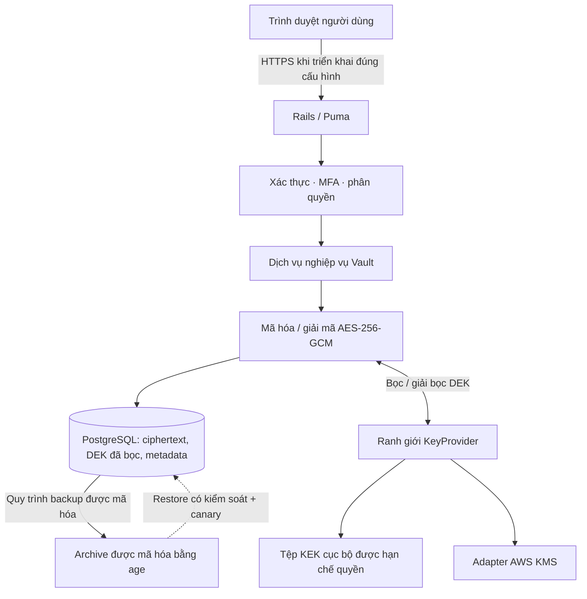

# Ruby Envelope Vault

> 🌐 Language / Ngôn ngữ: [English](README.md) | **Tiếng Việt**

[](https://github.com/dangkhoa2016/Rails-8-Envelope-Encryption-Vault/actions/workflows/ci.yml)
[](https://github.com/dangkhoa2016/Rails-8-Envelope-Encryption-Vault/actions/workflows/docs.yml)
[](https://github.com/dangkhoa2016/Rails-8-Envelope-Encryption-Vault/tree/v1.0.0)
[](LICENSE)


[](docs/ARCHITECTURE.md)
[](docs/KEY-MANAGEMENT.md)
[](docs/README.md)

**Kho bí mật tự lưu trữ xây dựng bằng Ruby on Rails 8, dành cho tài khoản đăng nhập, API key, biến môi trường và ghi chú riêng tư; sử dụng mã hóa phong bì xác thực, lịch sử phiên bản bất biến, kiểm soát truy cập và công cụ phục hồi.**

**Phạm vi phát hành:** `v1.0.0` gồm ứng dụng Rails, demo Kaggle/Colab có thể tái lập, quy trình kiểm thử bảo mật và tài liệu kỹ thuật song ngữ. Việc nghiệm thu deployment thật được mô tả ở [checklist production](docs/PRODUCTION-CHECKLIST.vi.md); xem [ma trận kiểm chứng](docs/qualification.vi.md) để hiểu đúng phạm vi bằng chứng.

[Bắt đầu](#khởi-chạy-nhanh--notebook-hoặc-container) · [Hiểu cơ chế mã hóa](#cơ-chế-mã-hóa-phong-bì) · [Xem bằng chứng](#kiểm-thử-và-bằng-chứng) · [Tra cứu tài liệu](#bản-đồ-tài-liệu)

## Mục lục

- [Chọn hướng đọc](#chọn-hướng-đọc-phù-hợp)
- [Vòng đời bí mật](#ví-dụ-vòng-đời-của-một-bí-mật)
- [Badge và bằng chứng](#hiểu-đúng-các-badge-và-bằng-chứng-release)
- [Dự án giải quyết vấn đề gì?](#dự-án-giải-quyết-vấn-đề-gì)
- [Chức năng và quy trình sử dụng](#chức-năng-và-quy-trình-sử-dụng)
- [Kiến trúc hệ thống](#kiến-trúc-hệ-thống)
- [Cơ chế mã hóa phong bì](#cơ-chế-mã-hóa-phong-bì)
- [Ranh giới bảo mật và mô hình đe dọa](#ranh-giới-bảo-mật-và-mô-hình-đe-dọa)
- [Khởi chạy nhanh — notebook hoặc container](#khởi-chạy-nhanh--notebook-hoặc-container)
- [Phát triển Rails trên máy thông thường](#phát-triển-rails-trên-máy-thông-thường)
- [Thao tác với vault](#thao-tác-với-vault)
- [Xoay khóa, sao lưu và khôi phục thảm họa](#xoay-khóa-sao-lưu-và-khôi-phục-thảm-họa)
- [Kiểm thử và bằng chứng](#kiểm-thử-và-bằng-chứng)
- [Điều kiện sẵn sàng production](#điều-kiện-sẵn-sàng-production)
- [Bản đồ tài liệu](#bản-đồ-tài-liệu)
- [Đóng góp và giấy phép](#đóng-góp-và-giấy-phép)

## Chọn hướng đọc phù hợp

| Tôi muốn... | Nên đọc trước | Có thể xác minh điều gì |
| --- | --- | --- |
| Hiểu sản phẩm trong vài phút | [Chức năng](#chức-năng-và-quy-trình-sử-dụng), [ví dụ sử dụng](#thao-tác-với-vault) | Luồng UI và ranh giới truy cập |
| Review mật mã | [Kiến trúc](docs/ARCHITECTURE.vi.md), [mô hình đe dọa](docs/THREAT-MODEL.vi.md), rồi `app/services/crypto/` | DEK mới, GCM, AAD và quá trình bọc khóa |
| Chạy demo dùng dữ liệu giả | [Quick start](#khởi-chạy-nhanh--notebook-hoặc-container), [notebook](docs/KAGGLE-SETUP.vi.md) | Bootstrap, health và thao tác thử nghiệm |
| Tái lập kiểm thử | [Tái lập](docs/reproducibility.vi.md), [ma trận kiểm chứng](docs/qualification.vi.md) | Test matrix, SHA, bằng chứng và giới hạn |
| Đánh giá key custody và phục hồi | [Quản lý khóa](docs/KEY-MANAGEMENT.vi.md), [backup/DR](docs/BACKUP-RESTORE.vi.md) | Xoay KEK, backup mã hóa và restore canary |
| Chuẩn bị vận hành | [Triển khai](docs/deployment.vi.md), [checklist](docs/PRODUCTION-CHECKLIST.vi.md) | Điều kiện nghiệm thu production độc lập |

Dự án chủ động phân biệt **kiểm chứng mã nguồn** với **nghiệm thu production**. Tag phát hành hoặc test PASS không phải quyền mặc định đưa credential thật lên host chưa đánh giá.

## Ví dụ: vòng đời của một bí mật

| Giai đoạn | Thao tác người dùng | Bảo mật và dữ liệu |
| --- | --- | --- |
| Tạo | Lưu một login giả | Payload mã hóa xác thực bằng DEK mới; metadata và DEK đã bọc được lưu |
| Sắp xếp | Chọn loại, tìm kiếm, yêu thích/lưu trữ | Phân quyền theo chủ sở hữu; metadata ngoài payload có thể thấy bởi người quản trị DB được cấp quyền |
| Reveal | Yêu cầu xem nội dung bảo vệ | Kiểm tra quyền và xác thực lại nếu cần trước khi giải mã |
| Cập nhật | Thay mật khẩu giả | Tạo phiên bản bất biến được mã hóa mới, giữ lịch sử trước đó |
| Phục hồi | Chọn phiên bản cũ | Giải mã trong phạm vi có quyền và ghi ra **phiên bản mới** |
| Kiểm toán | Xem session và audit | Sự kiện hỗ trợ điều tra, không cần ghi secret thô vào audit |
| DR | Tải backup mã hóa và khôi phục canary giả | Cần age identity **và** KEK lịch sử phù hợp, không chỉ dump PostgreSQL |

Mã nguồn Rails và test tương ứng nằm trong repo; xem [tổng quan kỹ thuật](docs/engineering-overview.vi.md). Không tuyên bố mã hóa đầu cuối khi không tin tưởng máy chủ hoặc bảo vệ trước Rails đang được cấp quyền nhưng bị chiếm.

## Hiểu đúng các badge và bằng chứng release

Badge **CI** và **Documentation** dẫn đến trạng thái GitHub Actions thực tế; không phải nhãn PASS cố định. Badge version, công nghệ và giấy phép phản ánh metadata repository, không chứng nhận runtime.

Khi đánh giá release, đối chiếu **commit SHA chính xác** trên [Actions](https://github.com/dangkhoa2016/Rails-8-Envelope-Encryption-Vault/actions) với [ma trận kiểm chứng](docs/qualification.vi.md). [Checklist production](docs/PRODUCTION-CHECKLIST.vi.md) quy định các bước nghiệm thu độc lập trước khi sử dụng bí mật thật.

## Dự án giải quyết vấn đề gì?

Ruby Envelope Vault là một ứng dụng tham khảo có thể kiểm tra mã nguồn, triển khai **mã hóa phía máy chủ cho các bí mật cá nhân và vận hành**. Mục tiêu là giảm hậu quả khi kẻ tấn công chỉ lấy được database: plaintext và khóa mã hóa khóa (KEK) chưa bọc không được lưu trong các bản ghi PostgreSQL.

Dự án kết hợp giao diện vault thường ngày với những vấn đề kỹ thuật mà một demo đơn giản dễ bỏ qua: cách ly khóa theo phiên bản, ranh giới nhà cung cấp khóa, xác thực và MFA, tạo phiên bản không ghi đè lịch sử, metadata kiểm toán, phục hồi có điều kiện kiểm soát và kiểm chứng mã nguồn trước phát hành.

**Đối tượng phù hợp:** lập trình viên Ruby/Rails tìm hiểu authenticated encryption; nhóm kỹ thuật đánh giá lưu giữ bí mật theo mô hình tự quản; người vận hành nghiên cứu cách tách backup khỏi quyền quản lý KEK. Đây là **mã nguồn tham khảo** và cần đánh giá độc lập trước khi lưu bí mật quan trọng trong môi trường thực tế.

### Công nghệ chính

| Tầng | Công nghệ | Vai trò |
| --- | --- | --- |
| Ứng dụng web | Rails 8.1.4, Puma, Hotwire (Turbo/Stimulus), Tailwind CSS | Giao diện, xác thực và luồng thao tác phía máy chủ |
| Database | PostgreSQL 17 | Người dùng, metadata, phiên bản được mã hóa, DEK đã bọc và audit event |
| Mã hóa dữ liệu | OpenSSL AES-256-GCM | Bảo vệ tính bí mật và toàn vẹn cho từng phiên bản |
| Quản lý khóa | KEK trong tệp cục bộ hoặc adapter AWS KMS | Bọc/giải bọc DEK ngoài ranh giới database |
| Xác thực | Mật khẩu, TOTP MFA, recovery code, session | Quyền truy cập, xác thực lại và quản lý phiên |
| Kiểm thử | Rails tests, system tests, RuboCop, Brakeman, bundler-audit, Docker | Kiểm chứng mã nguồn, phân tích tĩnh và khả năng tái lập |

Runtime chính được ghim tại [Ruby 3.4.11](.ruby-version); CI còn kiểm tra tương thích Ruby 4.0. Đây là **môi trường đã kiểm thử**, không phải cam kết hỗ trợ mọi nền tảng.

## Chức năng và quy trình sử dụng

| Tính năng | Khả năng |
| --- | --- |
| Bảy mẫu bí mật | Login, API key, environment, database, secure note, server/SSH, custom secret |
| Quản lý vault | Tạo, sửa, liệt kê, tìm kiếm, lọc theo loại/tag/trạng thái, đánh dấu yêu thích, lưu trữ |
| Phiên bản mã hóa | Mỗi lần cập nhật tạo phiên bản mã hóa mới; khôi phục tạo một phiên bản mới thay vì sửa lịch sử |
| Quyền truy cập | Reveal/export có kiểm tra quyền, xác thực lại với hành động nhạy cảm, cách ly dữ liệu theo chủ sở hữu |
| Bảo vệ tài khoản | TOTP MFA, recovery code được băm, hết hạn/thu hồi session và giới hạn tần suất |
| Kiểm toán | Security Activity Center theo tài khoản, lọc theo thời gian/kết quả, timeline và chi tiết an toàn (tính năng sau v1.0.0) |
| Vận hành KEK | Tạo/xác minh KEK, khóa cũ chỉ phục vụ giải mã, bọc lại DEK, chẩn đoán provider |
| Phục hồi | Dump PostgreSQL được mã hóa bằng age, kiểm tra SHA-256, restore có kiểm soát, diễn tập giải mã canary |

Đây **không phải** một hệ thống quản lý bí mật dùng chung cho doanh nghiệp đã công bố cam kết SLA/HA. Cần đánh giá mô hình phân quyền và giả định vận hành trước khi mở rộng.

## Security Activity Center (đang review)

**Security Activity Center** mới bổ sung thống kê sự kiện theo tài khoản, lọc 7/30/90 ngày hoặc toàn bộ lịch sử, outcome Completed/Failed/Recorded, timeline responsive và thông tin chi tiết được giới hạn an toàn. Chỉ những sự kiện được ghi nhận cho tài khoản đã đăng nhập mới xuất hiện. Đăng nhập thất bại không xác định danh tính và key rotation toàn hệ thống **không được tính** vào các số liệu cá nhân.

Đây là cải tiến đề xuất **sau tag công khai `v1.0.0`**, tag hiện tại không thay đổi. Timeline này không phải công cụ phát hiện xâm nhập toàn hệ thống hay log chống sửa đổi bằng mật mã. Đọc [tài liệu bảo mật Audit song ngữ](docs/AUDIT-ACTIVITY.vi.md) và kiểm tra CI feature branch trước khi coi tính năng đã phát hành.

## Kiến trúc hệ thống



Database lưu payload đã mã hóa xác thực và DEK đã được bọc. **KEK cần nằm trong một ranh giới tin cậy độc lập**; lưu bản sao KEK cùng backup database sẽ làm mất phần lớn giá trị của cơ chế tách biệt này.

Đọc tiếp [kiến trúc](docs/ARCHITECTURE.vi.md), [tổng quan kỹ thuật](docs/engineering-overview.vi.md) và [quản lý khóa](docs/KEY-MANAGEMENT.vi.md).

## Cơ chế mã hóa phong bì

Mỗi phiên bản bí mật bất biến được mã hóa riêng:

1. Ứng dụng tạo **DEK ngẫu nhiên 32 byte (256 bit)** và **nonce GCM 12 byte** mới.
2. Payload đã được serialize được mã hóa bằng AES-256-GCM.
3. Dữ liệu bổ trợ xác thực (AAD) gắn nội dung mã hóa với định danh người dùng, item và phiên bản.
4. `KeyProvider` được cấu hình dùng KEK do một ranh giới độc lập quản lý để bọc DEK.
5. PostgreSQL lưu ciphertext, nonce, authentication tag, tên provider, định danh KEK và DEK đã bọc—**không** lưu DEK hoặc KEK thô.
6. Giải mã đòi hỏi quyền ứng dụng hợp lệ, giải bọc DEK thành công và xác minh GCM. Nếu bị sửa nội dung envelope hoặc ngữ cảnh AAD, quá trình xác thực phải thất bại.

```text
BÍ MẬT + DEK mới + nonce + AAD
    ├─ AES-256-GCM ───────────────► ciphertext + authentication tag
    └─ DEK ── bọc bằng KEK ───────► DEK đã bọc + KEK ID
                                    │
                         Phiên bản mã hóa trong PostgreSQL
```

Khi xoay KEK, hệ thống có thể **bọc lại DEK mà không mã hóa lại ciphertext**. Quy trình xác minh DEK sau khi bọc lại và giữ các khóa cũ cần cho backup lịch sử; vì vậy không được tự ý xóa khóa phục hồi cũ.

Các định dạng và lỗi cụ thể nằm trong `app/services/crypto/`, `app/services/key_providers/` và [tài liệu quản lý khóa](docs/KEY-MANAGEMENT.vi.md).

## Ranh giới bảo mật và mô hình đe dọa

| Tình huống | Mức bảo vệ dự kiến | Giới hạn cần hiểu |
| --- | --- | --- |
| Chỉ bị lộ database | Payload bí mật vẫn ở dạng mã hóa; PostgreSQL không chứa KEK | Tên item, metadata và thông tin ngoài payload vẫn cần bảo vệ |
| Ciphertext, tag hoặc AAD bị sửa | AES-GCM từ chối envelope không hợp lệ | Mã hóa không chống được xóa dữ liệu hay gián đoạn dịch vụ |
| Session trình duyệt bị chiếm | Session controls, xác thực lại và MFA giúp giảm rủi ro | Một phiên được cấp quyền hợp lệ vẫn có khả năng truy cập bí mật |
| Máy chủ Rails hoặc KEK provider bị chiếm | Sự tách biệt hạn chế được một số dạng sự cố | Tiến trình Rails hợp lệ bị kiểm soát vẫn có thể giải mã |
| Bản backup bị đánh cắp | age bảo vệ dump database khi được cấu hình | Recovery identity và toàn bộ KEK liên quan phải được cất giữ riêng |
| Đánh mất KEK | Bản sao KEK độc lập giúp phục hồi | Chỉ có database dump thì **không thể** khôi phục plaintext |

**Không phải zero-knowledge:** dữ liệu được mã hóa phía máy chủ. Dự án chưa được chứng nhận là password manager production, thay thế HSM hoặc giải pháp tuân thủ quy định. Xem [mô hình đe dọa](docs/THREAT-MODEL.vi.md) và [chính sách báo cáo lỗ hổng](docs/SECURITY.vi.md).

## Khởi chạy nhanh — notebook hoặc container

Quy trình thuận tiện được thiết kế cho **Kaggle, Google Colab và container Ubuntu/Debian tương tự**, không cần systemd. Chỉ sử dụng **dữ liệu giả**. Cần truy cập mạng để cài phụ thuộc, đủ dung lượng đĩa và thư mục runtime có quyền ghi.

**Demo Kaggle / Google Colab đề xuất:** [Ruby Envelope Vault Full Demo](notebooks/Ruby_Envelope_Vault_Kaggle_Colab_Full_Demo.ipynb) là **notebook duy nhất được hỗ trợ** trên branch này. Notebook ghim commit ứng dụng đã review `0c6dcfe43ab610dbbe9cc1cd669ce345127980da`, kiểm tra Git tree rồi mới cài đặt demo. Notebook chạy đầy đủ Rails/Selenium tests với dữ liệu giả được mã hóa; đọc [hướng dẫn song ngữ](docs/KAGGLE-SETUP.vi.md).

**Phiên bản mã nguồn và phạm vi review**

| Mã nguồn | Nội dung có thể kiểm tra | Bằng chứng |
| --- | --- | --- |
| `main` hiện tại | Audit lọc tức thời, Vault Search không lộ từ khóa trên URL, Favorite tại chỗ và toast thông báo dùng chung | [CI hiện tại](https://github.com/dangkhoa2016/Rails-8-Envelope-Encryption-Vault/actions/workflows/ci.yml) và notebook ghim commit |
| [Bản phát hành mã nguồn cộng đồng `v1.0.0`](https://github.com/dangkhoa2016/Rails-8-Envelope-Encryption-Vault/tree/v1.0.0) | Rails hoàn chỉnh, Audit/Vault phản hồi tức thời, Favorite và toast dùng chung | Annotated tag trỏ tới bản nguồn đã review; notebook ghim commit ứng dụng là tổ tiên của tag |

Tag `v1.0.0` xác định lần phát hành mã nguồn đầu tiên cho cộng đồng. Repo Public clone ẩn danh; private fork/mirror yêu cầu quyền đọc và secret `GH_READ_TOKEN` chỉ đọc. Chỉ dùng dữ liệu giả; CI PASS không thay thế nghiệm thu production thật.

Notebook **tự mở Cloudflare Quick Tunnel công khai tạm thời sau khi Rails đã khởi động thành công**, hiển thị URL có thể bấm **không cần email OTP của Cloudflare**. Rails vẫn yêu cầu đăng nhập. Chỉ dùng dữ liệu giả, giữ kín mật khẩu demo; đặt `ENABLE_CLOUDFLARE_TUNNEL = False` để chỉ chạy localhost.

```bash
git clone https://github.com/dangkhoa2016/Rails-8-Envelope-Encryption-Vault.git
cd Rails-8-Envelope-Encryption-Vault
git checkout v1.0.0

# Bootstrap cài dịch vụ và kiểm tra crypto/security; chạy đủ Rails tests ngay sau đó.
chmod +x bootstrap.sh
RUN_TESTS=0 START_SERVER=0 ./bootstrap.sh

# Chạy toàn bộ Rails và Selenium suites với umask riêng dành cho test.
(
  source ./activate-runtime.sh
  umask 022
  RAILS_ENV=test bin/rails test
  RAILS_ENV=test bin/rails test:system
)

# Kiểm tra tình trạng trước khi mở server demo.
./bootstrap.sh doctor
./bootstrap.sh status
./bootstrap.sh start
```

Tạo owner đầu tiên **trong terminal tương tác**:

```bash
CREATE_OWNER=1 OWNER_EMAIL='owner@example.com' \
  START_SERVER=0 ./bootstrap.sh
```

Lệnh sẽ hỏi mật khẩu tối thiểu 14 ký tự. Khi chạy headless, bootstrap hỗ trợ `OWNER_PASSWORD_FILE` được bảo vệ quyền truy cập; không ghi mật khẩu thật vào script do Git quản lý hoặc shell history.

| Lệnh | Ý nghĩa |
| --- | --- |
| `START_SERVER=0 ./bootstrap.sh` | Chuẩn bị và kiểm tra runtime, không giữ Rails server chạy |
| `./bootstrap.sh start` | Khởi chạy dịch vụ được quản lý và Rails |
| `./bootstrap.sh status` | Xem trạng thái runtime/dịch vụ |
| `./bootstrap.sh doctor` | Kiểm tra, chẩn đoán môi trường |
| `./bootstrap.sh stop` | Dừng PostgreSQL/Redis do bootstrap quản lý |
| `source ./activate-runtime.sh` | Phục hồi biến môi trường trong terminal notebook mới |

Dữ liệu runtime nằm **ngoài thư mục Git**—trong `/kaggle/working` ở Kaggle hoặc `/content` ở Colab. Notebook có vòng đời tạm thời, không thích hợp lưu bí mật lâu dài. Đọc [hướng dẫn notebook đầy đủ](docs/KAGGLE-SETUP.vi.md) và [khắc phục sự cố](docs/troubleshooting.vi.md).

## Phát triển Rails trên máy thông thường

Trên máy phát triển thông thường, cài Ruby theo phiên bản được ghim, Bundler và PostgreSQL 17; dùng database test riêng và KEK thử nghiệm độc lập:

```bash
bundle install

# Cần PostgreSQL đang chạy và DATABASE_URL / TEST_DATABASE_URL
# phù hợp với môi trường phát triển của bạn.
export VAULT_KEK_DIR="$HOME/.local/share/ruby-envelope-vault/dev-keks"
bin/rails vault:keys:generate ID=kek-dev-01
export VAULT_ACTIVE_KEK_ID=kek-dev-01

bin/rails db:prepare
bin/rails test
bin/rails test:system
bin/rails server
```

Đây là **ví dụ phát triển**, không phải cấu hình triển khai production. Cần hạn chế quyền đọc thư mục KEK và dùng danh tính database chỉ dành cho development. Bộ Rails system test cũng cần cấu hình test/browser tương ứng; cấu hình CI là nguồn tham chiếu có thể tái lập.

Mã nguồn cung cấp [Dockerfile](Dockerfile) và [compose.yaml](compose.yaml), nhưng Docker build thành công không chứng minh production đã được cấu hình hay nghiệm thu.

## Thao tác với vault

Quy trình trải nghiệm với **tài khoản giả**:

1. Tạo owner, đăng nhập và kiểm tra dashboard cùng trang thiết lập bảo mật.
2. Bật TOTP MFA; giữ recovery code **bên ngoài chính vault đang thử nghiệm**.
3. Tạo một mục **Login** dùng username/password giả. Các loại khác gồm API key, `.env`, thông tin database và tài khoản server/SSH.
4. Chỉnh sửa mục, mở lịch sử rồi khôi phục một phiên bản trước; nội dung được khôi phục trở thành **phiên bản mới**, không ghi đè lịch sử.
5. Thử tìm kiếm, yêu thích/lưu trữ mục và luồng reveal/export có kiểm soát.
6. Xem các session tài khoản và audit event; thực hành thu hồi session thử nghiệm.

Tuyệt đối không đưa token, recovery key hoặc bí mật production thật vào notebook công khai, issue, demo fixture hay screenshot. Tham khảo [khả năng tiếp cận](docs/ACCESSIBILITY.vi.md) và [checklist production](docs/PRODUCTION-CHECKLIST.vi.md).

## Xoay khóa, sao lưu và khôi phục thảm họa

### Vòng đời KEK cục bộ

```bash
VAULT_KEK_DIR=/secure/vault/keks \
  bin/rails vault:keys:generate ID=kek-2026-01

VAULT_KEK_DIR=/secure/vault/keks \
VAULT_ACTIVE_KEK_ID=kek-2026-01 \
  bin/rails vault:keys:verify
```

Hỗ trợ **dry-run trước khi xoay khóa** và bọc lại DEK có kiểm soát. Giữ KEK cũ đến khi backup phụ thuộc vào nó được khôi phục và giải mã thành công trong môi trường độc lập; xem [hướng dẫn xoay khóa](docs/KEY-MANAGEMENT.vi.md).

### Backup mã hóa và nghiệm thu DR

```bash
# Chỉ khai báo trong môi trường vận hành có bảo vệ.
export BACKUP_AGE_RECIPIENT='age1...'
export DATABASE_URL='postgresql://...'
BACKUP_DIR=/secure/backups script/backup-db

# Kiểm tra checksum, khả năng giải mã và danh mục dump.
BACKUP_AGE_IDENTITY=/secure/recovery.agekey \
  script/verify-backup /secure/backups/<archive>.dump.age
```

**Backup được kiểm tra không đồng nghĩa đã chứng minh phục hồi thảm họa.** Nghiệm thu đầy đủ cần tải lại archive từ nơi lưu trữ, restore vào database mới được bảo vệ và giải mã **canary giả** bằng KEK được phục hồi độc lập. Làm theo [sao lưu và khôi phục](docs/BACKUP-RESTORE.vi.md), [nguồn gốc bằng chứng phục hồi](docs/RECOVERY-PROVENANCE.vi.md); không chạy lệnh restore thử nghiệm lên database quan trọng.

## Kiểm thử và bằng chứng

Lần nghiệm thu phát hành mã nguồn đầu tiên ghi nhận **6/6 job CI PASS trên `main`** và workflow tài liệu PASS. CI gồm phân tích tĩnh, Ruby lint/policy, Rails tests, đường chạy tương thích Ruby 3.4/4.0 và Docker build sạch.

| Kiểm tra | Phạm vi | Bằng chứng / cách chạy |
| --- | --- | --- |
| Unit/request/browser tests | Nghiệp vụ Rails, phân quyền/bảo mật và lỗi giao diện | [CI workflow](.github/workflows/ci.yml) · `bin/rails test` · `bin/rails test:system` |
| Kiểm thử mã hóa và bảo mật | Envelope và các bất biến về bảo mật | `script/crypto-self-test` · `script/security-self-test` |
| Chất lượng mã và dependency | RuboCop, Brakeman, bundler-audit, chính sách repository | [CI workflow](.github/workflows/ci.yml) |
| Tương thích runtime | Ruby 3.4 và Ruby 4.0, PostgreSQL 17 trên CI | [CI run](https://github.com/dangkhoa201/Rails-8-Envelope-Encryption-Vault/actions/runs/39538635309) |
| Đóng gói Docker | Build image không dùng cache | [CI workflow](.github/workflows/ci.yml) |
| Tài liệu song ngữ | Kiểm tra cặp ngôn ngữ, badge, liên kết nội bộ | [Docs workflow](.github/workflows/docs.yml) · `python3 script/doc-quality-check` |

Các kết quả này gắn với **revision đã được kiểm thử**, không tự động áp dụng cho mọi máy chủ. Kiểm thử synthetic recovery và CI PASS **không thay thế** penetration test, kiểm toán mật mã độc lập hoặc quyền phê duyệt triển khai production.

Đọc [ma trận kiểm chứng](docs/qualification.vi.md), [chỉ mục bằng chứng](docs/evidence-index.vi.md), [hướng dẫn tái lập](docs/reproducibility.vi.md) để phân biệt bằng chứng thực tế với những giả định vận hành còn phải xác minh.

## Điều kiện sẵn sàng production

`v1.0.0` **không khẳng định** một hệ thống production công khai đã vận hành an toàn. Mỗi lần triển khai cần nghiệm thu độc lập: HTTPS/reverse proxy thật; cấu hình hosts/origin/CSRF của Rails; tài khoản/MFA; lưu KEK phục hồi độc lập; backup mã hóa định kỳ và restore offsite kèm canary; monitoring/log filtering; accessibility thủ công.

Các file `ops/production.env.example` và `config/deploy.yml` là **template**, không chứa bộ secret đã sẵn sàng triển khai hoặc cấu hình hạ tầng được phê duyệt. Không công bố `.env` thực tế, AWS/KMS credential, age identity, key file, archive riêng tư hay dump database.

**Quyết định go-live:** theo [hướng dẫn triển khai](docs/deployment.vi.md), [checklist production](docs/PRODUCTION-CHECKLIST.vi.md) và [Ma trận kiểm chứng](docs/qualification.vi.md). Badge xanh không đủ làm bằng chứng nghiệm thu.

## Bản đồ tài liệu

Tất cả các tài liệu bên dưới đều có cặp EN/VI và liên kết chuyển ngôn ngữ.

| Chủ đề | Tiếng Việt | English |
| --- | --- | --- |
| Chỉ mục tài liệu | [Mục lục](docs/README.vi.md) | [Index](docs/README.md) |
| Kiến trúc | [Kiến trúc](docs/ARCHITECTURE.vi.md) | [Architecture](docs/ARCHITECTURE.md) |
| Thiết kế kỹ thuật | [Tổng quan](docs/engineering-overview.vi.md) | [Engineering overview](docs/engineering-overview.md) |
| Mô hình bảo mật | [Mô hình đe dọa](docs/THREAT-MODEL.vi.md) | [Threat model](docs/THREAT-MODEL.md) |
| Audit theo tài khoản | [Trung tâm Audit](docs/AUDIT-ACTIVITY.vi.md) | [Audit Activity Center](docs/AUDIT-ACTIVITY.md) |
| KEK và xoay khóa | [Quản lý khóa](docs/KEY-MANAGEMENT.vi.md) | [Key management](docs/KEY-MANAGEMENT.md) |
| Môi trường demo | [Thiết lập notebook](docs/KAGGLE-SETUP.vi.md) | [Notebook setup](docs/KAGGLE-SETUP.md) |
| Backup và DR | [Sao lưu và phục hồi](docs/BACKUP-RESTORE.vi.md) | [Backup and restore](docs/BACKUP-RESTORE.md) |
| Phạm vi nghiệm thu | [Ma trận kiểm chứng](docs/qualification.vi.md) | [Qualification](docs/qualification.md) |
| Bằng chứng | [Chỉ mục bằng chứng](docs/evidence-index.vi.md) | [Evidence index](docs/evidence-index.md) |
| Tái lập | [Tái lập](docs/reproducibility.vi.md) | [Reproducibility](docs/reproducibility.md) |
| Triển khai | [Hướng dẫn triển khai](docs/deployment.vi.md) | [Deployment](docs/deployment.md) |
| Accessibility | [Khả năng tiếp cận](docs/ACCESSIBILITY.vi.md) | [Accessibility](docs/ACCESSIBILITY.md) |
| Xử lý lỗi | [Khắc phục sự cố](docs/troubleshooting.vi.md) | [Troubleshooting](docs/troubleshooting.md) |
| Đóng góp | [Hướng dẫn đóng góp](.github/CONTRIBUTING.vi.md) | [Contributing](.github/CONTRIBUTING.md) |
| Báo cáo lỗ hổng | [Chính sách bảo mật](docs/SECURITY.vi.md) | [Security policy](docs/SECURITY.md) |

## Đóng góp và giấy phép

Hoan nghênh đóng góp, báo lỗi có thể tái hiện và cải thiện tài liệu. Đọc [hướng dẫn đóng góp](.github/CONTRIBUTING.vi.md), chỉ dùng dữ liệu giả trong ví dụ và không công bố bí mật thật. Báo cáo lỗ hổng bảo mật qua kênh riêng được chỉ dẫn trong [chính sách bảo mật](docs/SECURITY.vi.md).

Dự án được phát hành theo [giấy phép MIT](LICENSE). Bản quyền © 2026 **Đăng Khoa** <i.am@dangkhoa.dev>.

**Nguyên tắc của dự án:** chất lượng mã nguồn có bằng chứng, ranh giới tin cậy rõ ràng và khả năng phục hồi quan trọng hơn các tuyên bố production chưa được kiểm chứng.
