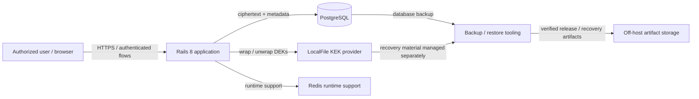
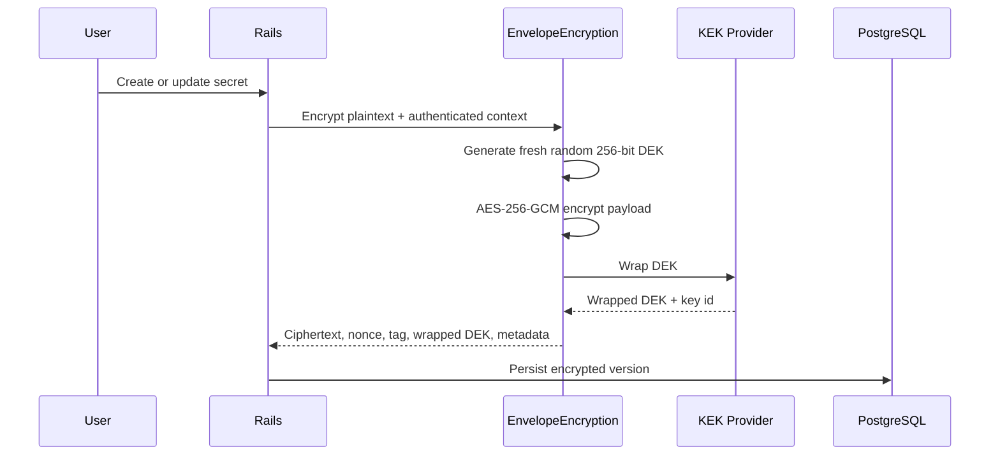
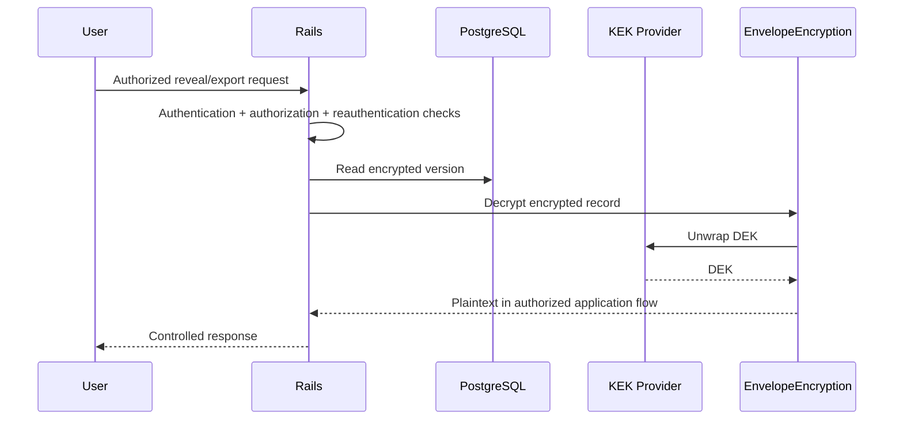
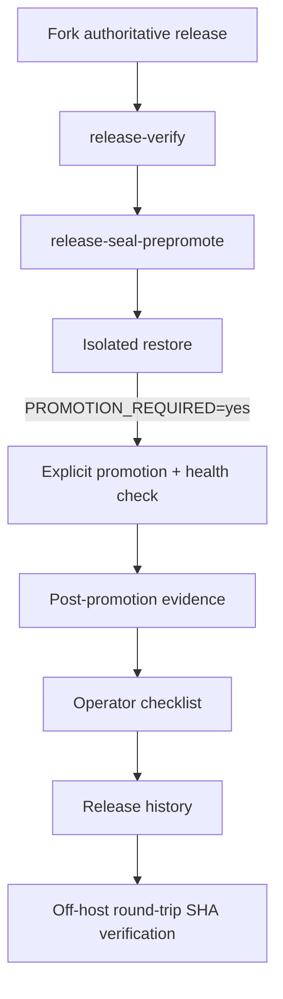

# Architecture Overview — FIX33

This document is a public, source-controlled architecture map for Ruby Envelope Vault. It summarizes already-established architecture and threat-model boundaries; it does not introduce new cryptographic claims.

## System context

## Envelope-encryption path

## Read / reveal path

## Trust boundaries

- PostgreSQL is expected to contain ciphertext and encryption metadata, not plaintext vault payloads or the KEK.
- The KEK is kept outside PostgreSQL and Git.
- A live authorized Rails host with KEK access is trusted and can decrypt data. This is therefore not a zero-knowledge design.
- Public demo deployments use synthetic data only and must not reuse personal KEKs or real credentials.
- Backup/recovery material and source/public showcase artifacts have different sensitivity and are packaged separately.

## Release-evidence path

The promotion boundary is deliberate: the pre-promotion seal never changes the live `current` symlink or restarts Puma.
