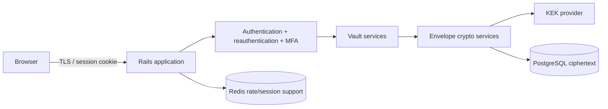
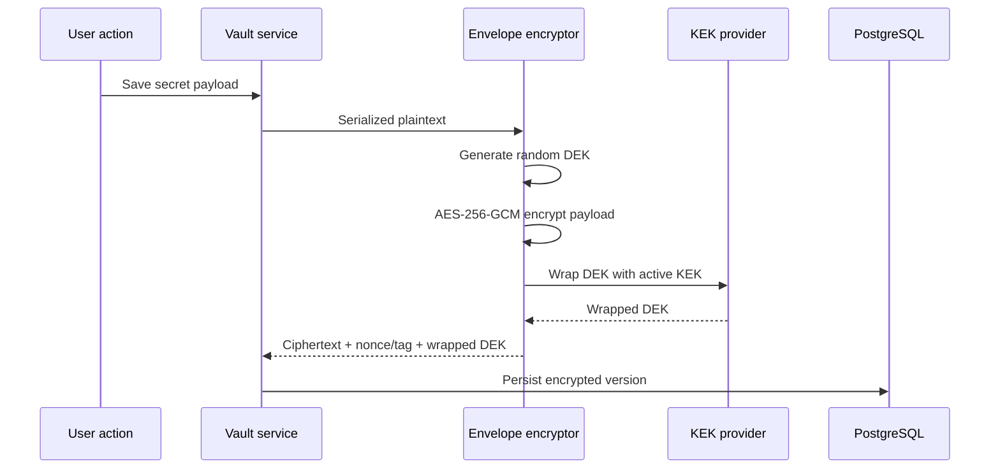
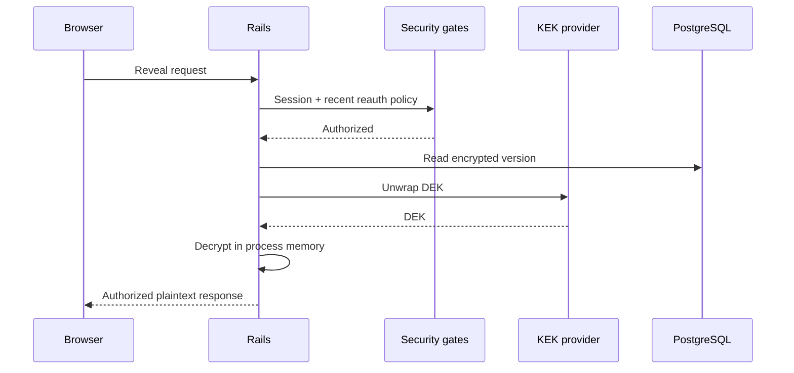
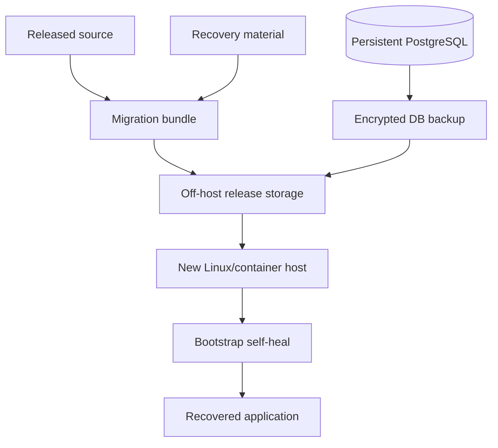

# FIX25 Architecture & Threat Model Diagrams

These diagrams summarize the current Ruby Envelope Vault trust and encryption boundaries.

## Application request path

The live Rails process is trusted because it can request the KEK and decrypt authorized vault payloads.

## Envelope encryption flow

## Reveal flow

## Backup / recovery trust boundary

Important boundary: a host that has both the application runtime and the usable KEK is trusted. This project is not a zero-knowledge vault.

## Threat-model summary

Primary mitigations include:

- encrypted-at-rest vault payloads and encrypted tags;
- random per-version DEKs;
- KEK separation;
- immutable encrypted version history;
- recent reauthentication for sensitive operations;
- MFA and recovery codes;
- session expiry/revocation;
- production rate limiting;
- audit metadata rejection/allowlisting;
- source/migration artifact leak checks;
- off-host checksum round trips;
- tested bootstrap/recovery continuity.

These controls reduce risk but do not protect against a fully compromised trusted Rails host while it has access to the KEK.
