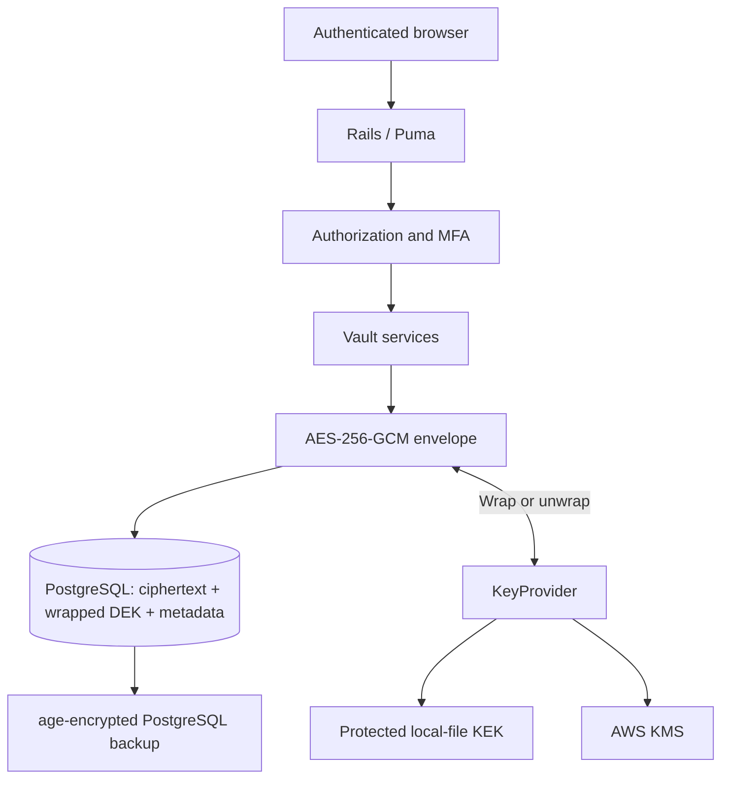

# Architecture and encryption data flow — v1.0.0

> 🌐 Language / Ngôn ngữ: **English** | [Tiếng Việt](ARCHITECTURE.vi.md)

## Overview

Ruby Envelope Vault separates (1) user-facing Rails workflows, (2) PostgreSQL storage of encrypted versions and metadata, and (3) **key custody** through a KeyProvider. The aim is to protect encrypted payloads when only the database is compromised. A live, authorized Rails process with KEK access can still decrypt: this is **server-side, not zero-knowledge**, encryption; it is not a zero-knowledge design.

## Encrypt an immutable version

1. Controller/service checks the authenticated user's access and creates a new version identity.
2. Payload is serialized by `Crypto::PayloadSerializer`.
3. `Crypto::EnvelopeEncryptor` generates a **fresh 32-byte random DEK** and **12-byte random nonce** (a fresh random 256-bit DEK per version).
4. AAD includes `user_id`, `vault_item_id`, and `vault_item_version_id`; AES-256-GCM produces ciphertext and a **16-byte authentication tag**.
5. The selected KeyProvider wraps the DEK with a separate KEK and records the corresponding `kek_id`.
6. The encrypted version persists the ciphertext, nonce, tag, provider identity, wrapped DEK and required metadata.

No plaintext KEK is placed in PostgreSQL. User-visible metadata should not be assumed encrypted merely because secret payloads are encrypted.

## Reveal and version restore

For an authorized reveal, Rails retrieves the envelope, the provider unwraps its DEK, and GCM verifies the tag and AAD before returning plaintext to the authorized application flow. A wrong provider, damaged ciphertext or context mismatch must fail safely.

To restore an older version, `Vault::RestoreVersion` decrypts it, then `Vault::UpdateItem` creates a **new encrypted version** carrying the restored payload. Restoring does not mutate historical versions in place.

## Key-provider choices

| Provider | Custody boundary | Risk to manage |
| --- | --- | --- |
| `local_file` | Restricted KEK files outside Git and database | Host filesystem and backup separation |
| AWS KMS | Cloud-managed KMS permissions and API | IAM/region/key availability and recovery governance |

For migration/rotation, an operator can wrap existing DEKs under a new KEK without rewriting payload ciphertext. Old key material remains necessary for old backups until their recovery requirements have been retired through evidence-based checks. See [Key management](KEY-MANAGEMENT.md).

## Storage, audit and recovery

PostgreSQL also stores user accounts, item metadata and audit records; it should be treated as confidential even when ciphertext is encrypted. Backups should be encrypted using **age**, and recovery identity and KEKs should be stored separately from archives.

A robust DR proof requires a checksum, offsite retrieval, fresh guarded restore, and successful decrypt of an exact **synthetic canary**. See [Backup/restore](BACKUP-RESTORE.md).

## Explicit trust limitations

- Compromise of Rails while it can use a KEK may expose secrets.
- GCM does not prevent deletion, rollback of entire database files, traffic interception before TLS or availability attacks.
- MFA and session controls reduce some account risks but cannot eliminate stolen authorized-session access.
- CI verifies source behavior only; TLS and host configuration need separate live acceptance. The `PROMOTION_REQUIRED=yes` gate is a workflow requirement, not proof that production promotion happened.

## Further inspection

[Engineering overview](engineering-overview.md) · [Threat model](THREAT-MODEL.md) · [Qualification](qualification.md) · [Deployment](deployment.md) · [Evidence](evidence-index.md)
