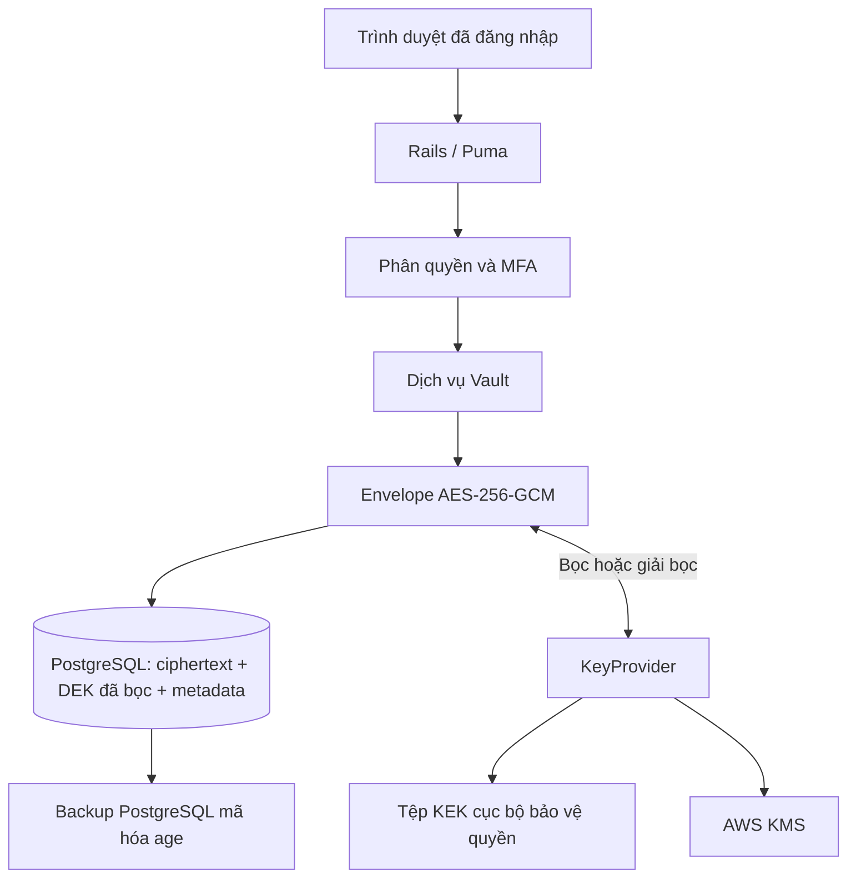

# Kiến trúc và luồng mã hóa — v1.0.0

> 🌐 Language / Ngôn ngữ: [English](ARCHITECTURE.md) | **Tiếng Việt**

## Tổng quan

Ruby Envelope Vault tách (1) nghiệp vụ Rails cho người dùng, (2) PostgreSQL lưu phiên bản mã hóa và metadata, và (3) **quản lý khóa** qua KeyProvider. Mục tiêu là bảo vệ payload khi kẻ tấn công chỉ chiếm được database. Rails đang chạy có quyền dùng KEK vẫn có thể giải mã: đây là mã hóa **phía máy chủ, không phải zero-knowledge**.

## Mã hóa phiên bản bất biến

1. Controller/service kiểm tra quyền người dùng và tạo định danh phiên bản mới.
2. `Crypto::PayloadSerializer` serialize payload.
3. `Crypto::EnvelopeEncryptor` sinh **DEK ngẫu nhiên 32 byte** và **nonce ngẫu nhiên 12 byte** mới.
4. AAD chứa `user_id`, `vault_item_id`, `vault_item_version_id`; AES-256-GCM tạo ciphertext và **authentication tag 16 byte**.
5. KeyProvider được chọn bọc DEK bằng KEK độc lập, lưu định danh `kek_id`.
6. Bản ghi phiên bản lưu ciphertext, nonce, tag, tên provider, DEK đã bọc và metadata cần thiết.

Không lưu KEK dạng plaintext trong PostgreSQL. Không mặc định rằng metadata hiển thị cho người dùng cũng được mã hóa như secret payload.

## Reveal và phục hồi phiên bản

Khi reveal hợp lệ, Rails lấy envelope, provider giải bọc DEK, GCM xác minh tag/AAD trước khi trả plaintext cho luồng ứng dụng đã cấp quyền. Provider sai, ciphertext bị hỏng hoặc AAD sai phải bị từ chối an toàn.

Để phục hồi một phiên bản cũ, `Vault::RestoreVersion` giải mã rồi gọi `Vault::UpdateItem` tạo **phiên bản mới** chứa payload đã khôi phục. Không ghi đè ciphertext lịch sử.

## Các lựa chọn KeyProvider

| Provider | Ranh giới quản lý khóa | Rủi ro cần quản trị |
| --- | --- | --- |
| `local_file` | File KEK hạn chế quyền, ngoài Git/database | Phân tách filesystem và backup |
| AWS KMS | API và quyền IAM của KMS | Region, key availability, quyền và phục hồi |

Khi xoay khóa, operator có thể bọc lại DEK bằng KEK mới mà không đổi ciphertext của payload. KEK cũ vẫn cần cho backup lịch sử cho đến khi chứng minh không còn phụ thuộc. Xem [Quản lý khóa](KEY-MANAGEMENT.vi.md).

## Database, audit và recovery

PostgreSQL còn lưu tài khoản, metadata và audit record; vẫn cần coi database là dữ liệu mật. Backup nên mã hóa bằng **age**, age identity và KEK phục hồi phải lưu tách biệt archive.

Nghiệm thu DR vững chắc cần checksum, tải lại từ offsite, restore vào DB mới có chốt bảo vệ và giải mã **canary giả** chính xác. Xem [Sao lưu/phục hồi](BACKUP-RESTORE.vi.md).

## Các giới hạn tin cậy

- Máy chủ Rails bị chiếm khi có quyền dùng KEK có thể làm lộ bí mật.
- GCM không chống xóa dữ liệu, rollback toàn DB, chặn lưu lượng trước TLS hoặc tấn công tính sẵn sàng.
- MFA và session giảm một số rủi ro tài khoản nhưng không triệt tiêu trường hợp phiên hợp lệ bị chiếm.
- CI chỉ kiểm tra mã nguồn; TLS và cấu hình host phải được nghiệm thu riêng.

## Tài liệu liên quan

[Tổng quan kỹ thuật](engineering-overview.vi.md) · [Mô hình đe dọa](THREAT-MODEL.vi.md) · [Ma trận kiểm chứng](qualification.vi.md) · [Triển khai](deployment.vi.md) · [Bằng chứng](evidence-index.vi.md)
